<p align="center"></p>

<h1 align="center">Musset</h1>

<p align="center"><strong>A Mac writing app for people who finish books.</strong></p>

<p align="center">
<a href="https://musset.app"><strong>musset.app</strong></a> ·
<a href="https://musset.app/download"><strong>Download for Mac</strong></a> ·
<a href="https://musset.app/compare/">Compared with Scrivener, Ulysses, iA Writer and Manuskript</a>
</p>

<p align="center">
<a href="https://github.com/Musset-App/musset/actions/workflows/ci.yml"></a>
<a href="LICENSE"></a>

</p>

Free while it is a beta, then US$9.90 once from version 1.0, and open source either way. macOS 14 or later, Apple silicon.

Musset is as calm as a blank page, as structured as a manuscript, and as fast on the keyboard as WordStar. It has an
editor inside who reads, questions and annotates, and who never writes a word for you. Your book stays a folder of
plain text files with its whole history, in English, French, German, Spanish, Italian or Portuguese, typeset in
EB Garamond when it is time to print.

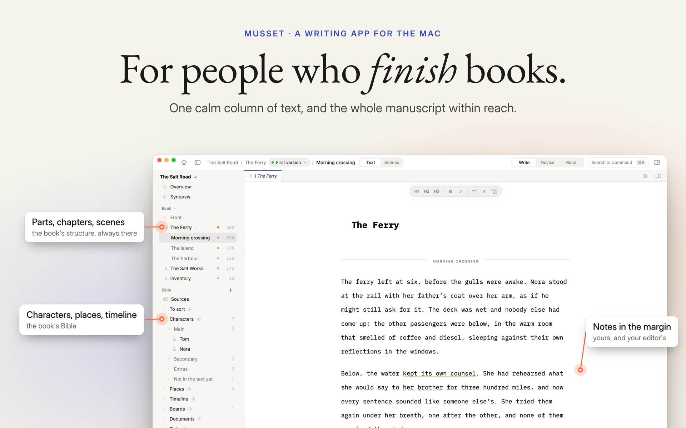

- [Why Musset](#why-musset)
- [Writing](#writing)
- [Keyboard](#keyboard)
- [Structure: chapters, scenes, Bible](#structure-chapters-scenes-bible)
- [Boards, panes and windows](#boards-panes-and-windows)
- [Versions, under control](#versions-under-control)
- [Revising with an editor](#revising-with-an-editor)
- [The editor inside](#the-editor-inside)
- [Six languages](#six-languages)
- [From draft to publisher](#from-draft-to-publisher)
- [Bringing a book in](#bringing-a-book-in)
- [Price, and Musset Sync](#price-and-musset-sync)
- [Your book on disk](#your-book-on-disk)
- [Shortcuts](#shortcuts)
- [Privacy](#privacy)
- [Install](#install)
- [Build from source](#build-from-source)
- [Tests](#tests)
- [Project layout](#project-layout)
- [Translating the interface](#translating-the-interface)
- [Contributing](#contributing)
- [Licence](#licence)

---

## Why Musset

Writing tools tend to choose one of three things: a calm editor, a manuscript organiser, or a machine that writes for
you. Musset is the first two, and refuses the third.

- **Your words stay yours.** The AI in Musset critiques, quotes and asks; on principle, it never generates prose for
  your book. Everything works with the AI switched off.
- **Your files stay yours.** Each chapter is a Markdown file you can open anywhere; the history is ordinary git. Leave
  Musset whenever you like and your book comes with you, whole.
- **The keyboard first.** Four keyboard modes, a command bar for everything, and modes that remove everything but the
  text.
- **The whole road to the publisher.** Revision with an editor, each country’s manuscript format, and professionally
  typeset PDFs.

## Writing

- **A plain-text editor, one column.** Markdown underneath, shown as you would read it: emphasis markers fold away from
  the paragraph you are in, scene markers become quiet headers.
- **Write, Revise, Read.** Three modes in the toolbar. In Revise, every change becomes a correction you can weigh later.
  In Read, the chapter or the whole book is typeset beside the text, page by page.
- **Focus.** Focus mode dims everything but the paragraph you are writing; typewriter scrolling keeps the line in the
  middle of the screen; a minimap, line numbers and repetition highlighting are a keystroke away.
- **Kiosk mode** (⌃⌘K). Your Mac becomes a typewriter: Musset takes the whole screen, menu bar, Dock and notch included,
  and app switching is off until you leave. Chapters, notes and the three modes stay at hand.
- **Ultra Focus** (⌃⌘U). Only the text, only forward: no interface, no going back. Three levels — *Light* lets you mend
  the sentence you are in, *Normal* lets you backspace, *Hardcore* lets you do neither. Optionally locked until a word
  count or a time is reached. What you wrote lands at the end of the chapter, in a new scene, or in the drafts.
- **Light and dark**, following macOS or chosen from the command bar.

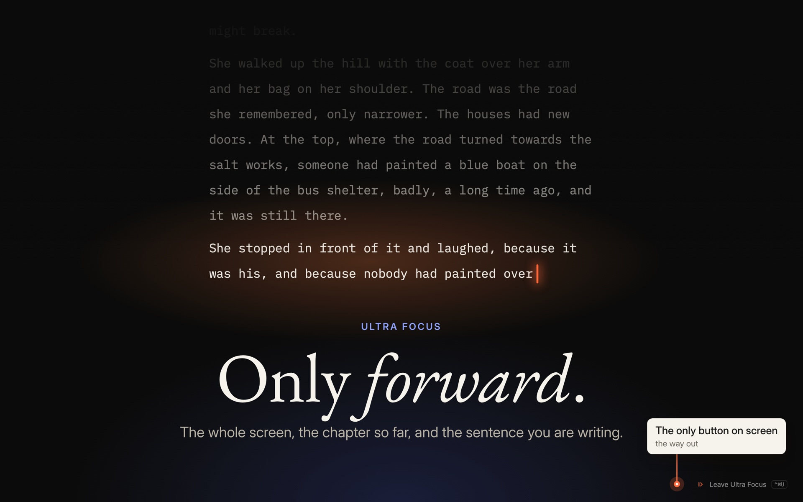

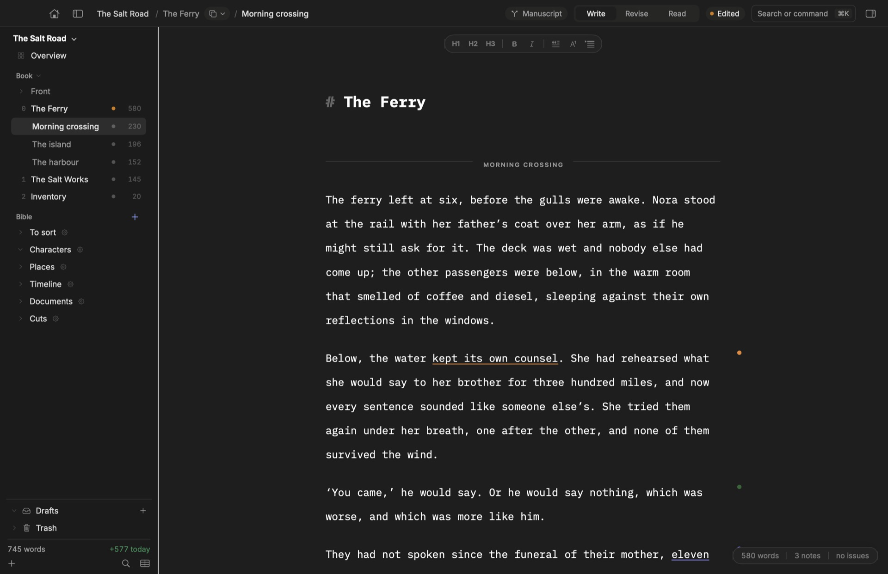

## Keyboard

Choose the keys your hands already know in **Settings › Keyboard**. One mode at a time; ⌘ stays Musset’s in every mode,
and AZERTY keyboards are handled.

| Mode | What it brings |
|---|---|
| **Mac** (default) | The shortcuts of every Mac app and of Word. |
| **WordStar** | The cursor diamond (⌃E ⌃S ⌃D ⌃X…), blocks that stay marked (⌃K B / ⌃K K), copy and move across chapters, place markers (⌃K 0–9 / ⌃Q 0–9). |
| **vi** | Normal, insert and visual modes; motions and text objects that understand prose — sentences (`(` `)` `is` `as`), paragraphs, words with apostrophes; `.` to repeat. Esc belongs to the editor. |
| **Emacs** | The mark, the region and the kill ring (⌃Space ⌃W ⌃K ⌃Y), Meta by Esc — and ⌥ still types your accents. |

The **command bar** (⌘K) does everything else: go to any chapter or scene in any of your books, run a critique, search
the text, change the appearance, export.

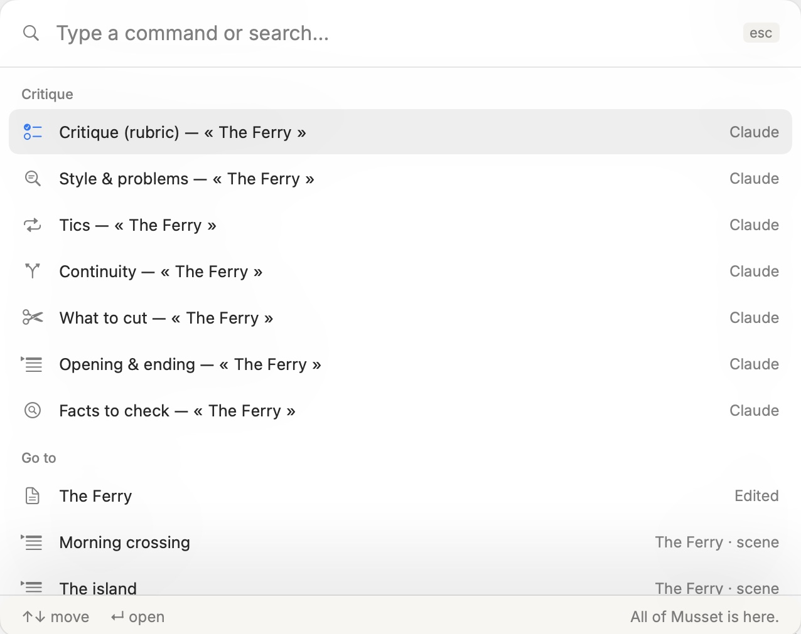

## Structure: chapters, scenes, Bible

- **Parts, chapters and scenes**, each with a status (draft, written, revised, final) and a word count. Drag to reorder;
  set chapters aside as drafts without deleting them.
- **The plot grid** (⌘5): one row per scene, columns for the main plot, subplots, characters and motifs, filled by you
  or proposed by the AI from your text.
- **The Bible**: a visible `bible/` folder in your book for sheets (characters, places, timeline), documents and cuts.
  It is yours — readable in the Finder, tracked in the history. A passage of some length you cut from a chapter goes to
  the Cuts on its own, with where it came from.
- **Scene cards.** A chapter’s scenes side by side, each card holding its scene’s whole text. Pick a card up by its
  header and put it down elsewhere: the text follows. Split a scene between two paragraphs, merge it with the next,
  rename it in place.
- **The book at a glance.** The overview shows every chapter with how it opens and how it closes; step into a part,
  where scenes move from one chapter to another, then into a chapter.
- **The cast, kept for you.** Musset reads the chapters as they come and keeps who appears, how often and under which
  names. A sheet has two parts: your notes, and what the chapters actually state, each with the chapter it comes from.
- **Renamed everywhere.** A character changes name in every chapter, note and sheet; you see each line before it
  changes, and one undo takes it all back.
- **Notes and todos** anchored to passages, quick capture from anywhere, and a plan of the chapter (⌘6).

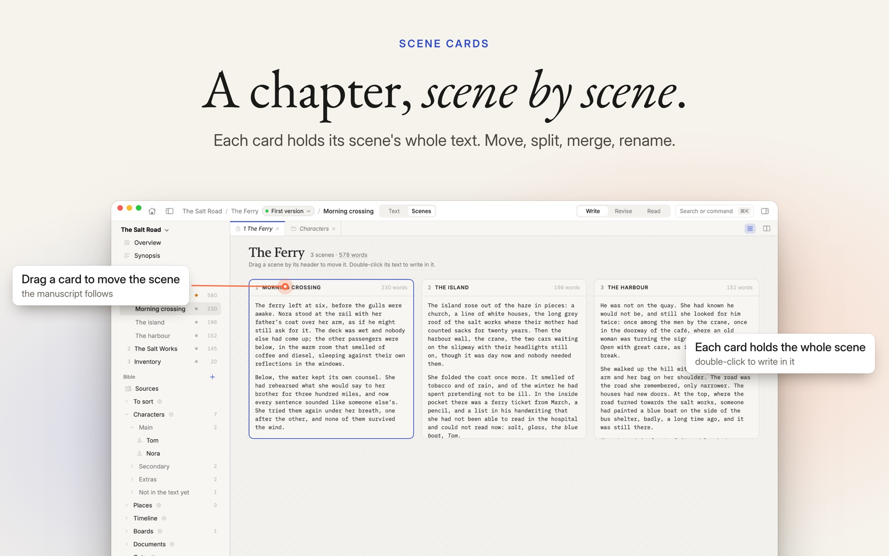

## Boards, panes and windows

- **Cork boards inside the book.** Pin a character, a place and its map, a scrap of dialogue, and draw the line between
  them. Drop a sheet from the Bible and it becomes a card; arrows catch the side of a card and stay with it; a pen and
  a highlighter for the rest. Beside a chapter, the cards of the people and places in the paragraph you are writing
  light up.
- **An open format.** A board is a [JSON Canvas](https://jsoncanvas.org) file in your book’s folder, readable without
  Musset.
- **Panes.** Drag a chapter or a sheet onto the side of a pane and it opens there: two chapters, both live, each with
  its own undo. Keep a layout under a name and call it back from the keyboard.
- **Windows.** Pull a tab out and it becomes a window of its own; park the board and the Bible on a second screen.

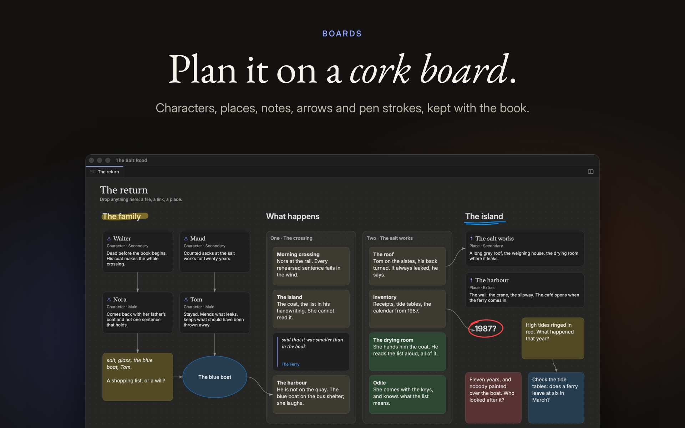

## Versions, under control

No more `chapter-3-final-v2-REAL.docx`. Musset quietly keeps every state of your book as you write: you never save a
copy, never rename a file, and nothing you delete is ever really gone.

- **Two versions of a chapter, side by side.** Hesitating between two directions? Write both. Read them next to each
  other with what differs marked, and choose which one goes in the book — then change your mind whenever you like.
- **A draft on the side.** Try something bold on the whole book in a parallel draft; the real manuscript does not move.
  Bring back what works, paragraph by paragraph, or put the draft away.
- **Back in time.** See any chapter as it was last Tuesday, or the day you sent it out. Set milestones — a submission,
  a reading, the end of a draft — and go back to any of them. Compare any two moments of a chapter.

Behind it is git, the system the software world relies on to keep track of its work. You never have to see it.

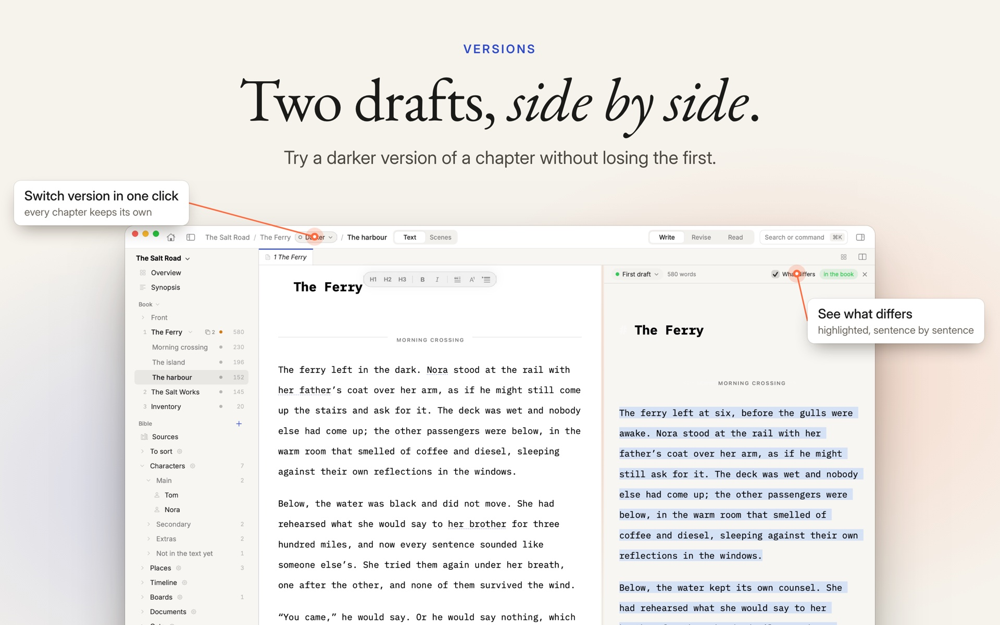

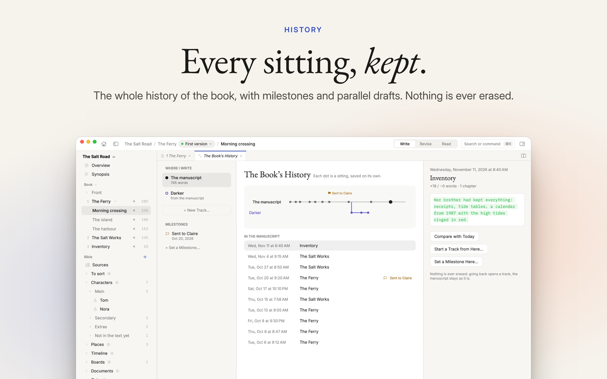

## Revising with an editor

- **Corrections in the text.** What goes is struck through, what comes is in green, comments sit on the passage they
  are about. Accept or refuse each one, or all at once; each correction carries the name of who made it.
- **Your own revisions too.** Switch to Revise (⇧⌘E) and your changes become corrections you can weigh later.
- **Editors who live in Word.** Export a `.docx`; their tracked changes and comments come back as corrections and notes,
  even on a text you kept working on in the meantime.
- **Who wrote what** (⌥⌘B), when a book is shared.

Corrections are stored as [CriticMarkup](https://criticmarkup.com) in the chapter itself — plain text, readable
anywhere: `{++added++}`, `{--deleted--}`, `{~~old~>new~~}`, `{==highlighted==}{>>comment<<}`, followed by `{@Name}` for
who made it.

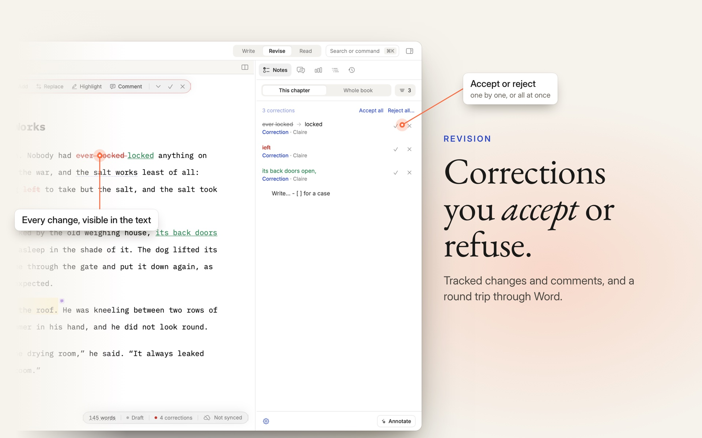

## The editor inside

The AI reads like a good editor: it quotes your sentence, says what it sees, and asks a question. It never rewrites
your book.

- **Margin notes.** Critique, questions, continuity checks, facts to verify, tics, cuts — and praise, which has its own
  colour. Each note quotes the passage it is about; you tick it off when it is dealt with.
- **A full reading in one click.** Style and problems, tics, continuity, what to cut, the opening and the ending, facts to
  check.
- **Critique against a rubric.** A blind reading of the chapter, scored by criteria chosen for your genre, every claim
  backed by a quotation that Musset checks against the text.
- **Your own rules.** Write your style sheet once, numbered; Musset checks each chapter against it and leaves the
  findings in the margin, citing the rule.
- **Talk it through.** A chat about the chapter you are in, with what it points at landing in the margin as notes.
- **Grammar, confirmed.** A rule-based checker cannot tell what a sentence means; optionally, the AI confirms its
  grammar alerts before they are underlined.

The AI runs through **your own account** with the provider, signed in from Musset: Claude through the official Claude
Code command-line tool, ChatGPT through the official Codex command-line tool. Musset holds no AI provider keys and
takes no margin.

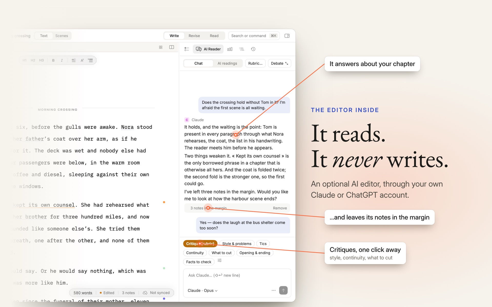

| Notes | Chat |
|---|---|
| 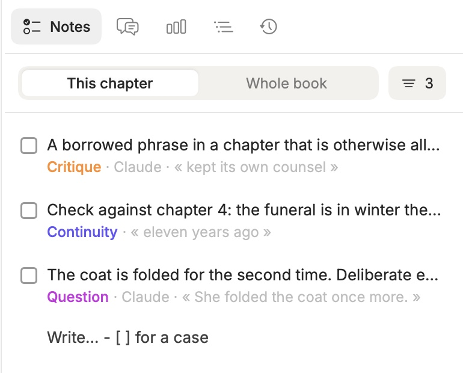 | 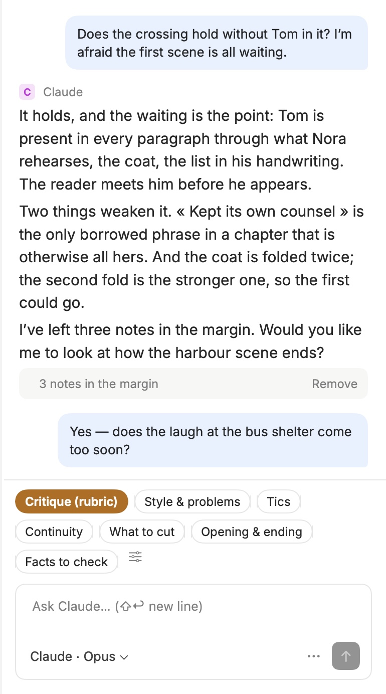 |

## Six languages

| | Interface | Typography | Spelling & grammar | Manuscript |
|---|---|---|---|---|
| English (US, UK) | ✓ | “ ” / ‘ ’, em or spaced en dash | LanguageTool | Standard manuscript format |
| Français | ✓ | « » with non-breaking spaces, dialogue dash | LanguageTool | Feuillets (25 × 60) |
| Deutsch (DE, CH) | ✓ | „ “ / « » in Switzerland, ß → ss, z. B. | LanguageTool | Normseite (30 × 60) |
| Español (ES, Latin America) | ✓ | « » or “ ”, raya for dialogue | LanguageTool | A4, characters with spaces |
| Italiano | ✓ | « », È, po’ | LanguageTool | Cartella (1,800 battute) |
| Português (PT, BR) | ✓ | « » or “ ”, travessão | LanguageTool | A4, characters with spaces |

Each book has its language and variant (Book Settings). Musset applies its typography as you type, and checks spelling
and grammar with [LanguageTool](https://languagetool.org), which runs **inside Musset, on your Mac**: nothing is sent
anywhere. Brazilian and European Portuguese each have their own interface.

## From draft to publisher

**Reading mode** typesets the chapter or the whole book next to the text, as it will print.

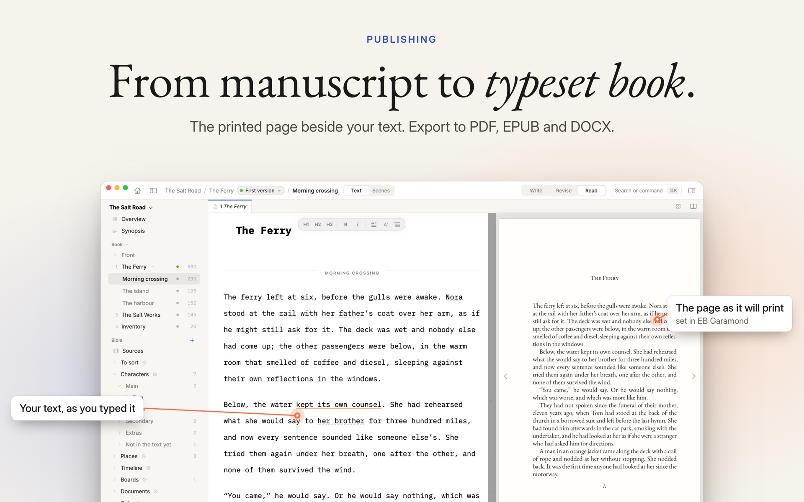

**PDFs are typeset like a book**, with [Typst](https://typst.app) and EB Garamond:

- each paragraph set as a whole, with hyphenation by the rules of the book’s language;
- true small capitals for chapter titles, old-style figures, ligatures, ornaments between scenes;
- facing pages with inside and outside margins, folios on the outer edge, parts on a right-hand page;
- the trade sizes of your market (13 × 20, 14 × 21, 12.5 × 20.5 cm, B-format, 5.5 × 8.5 and 6 × 9 in…) and crop marks
  for the printer;
- a cover, title page, dedication, epigraph, contents, acknowledgements and colophon if you want them.

| | |
|---|---|
| 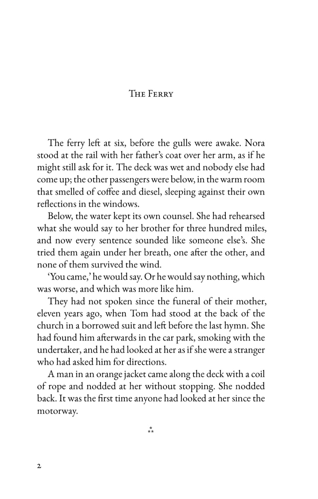 | 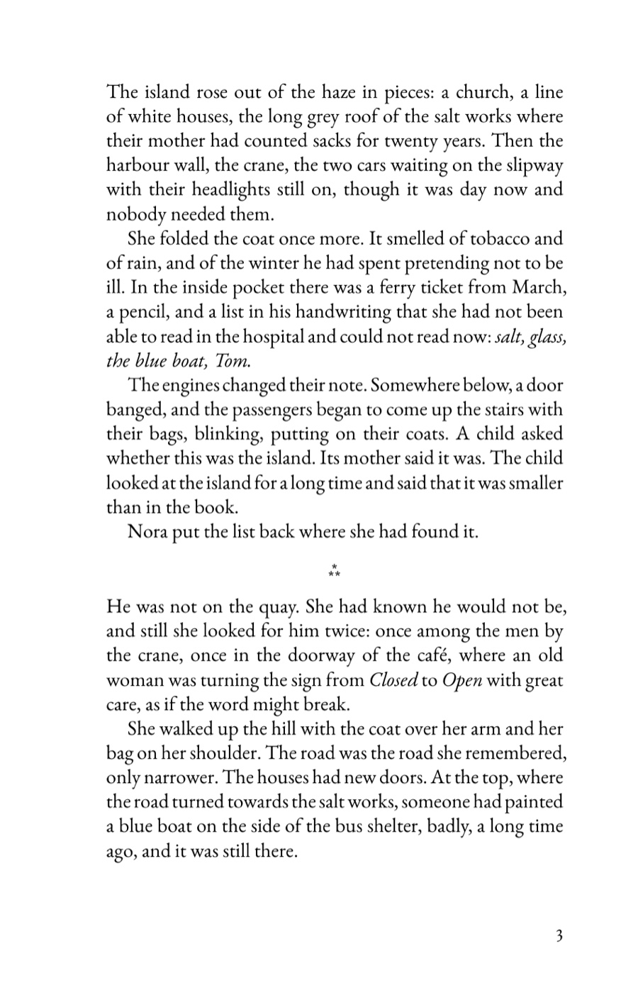 |

**Manuscripts for submission** follow each country’s conventions, and count the way publishers count:

| Market | Format |
|---|---|
| US, UK | Standard manuscript: Letter or A4, double spaced, contact and word count on page one, “Surname / TITLE / page” header |
| France | Feuillets: 25 lines of 60 signs, 1,500 signs a page |
| Germany, Switzerland | Normseite: 30 lines of 60 characters |
| Italy | Cartella: 30 lines of 60 battute |
| Spain, Portugal, Brazil | A4, 1.5 spacing, characters with spaces |

Entering a literary prize? Send the manuscript under a pseudonym, without your name or contact. Musset also exports
**Word** (`.docx`, with styles your editor can use) and **EPUB**.

| | |
|---|---|
| 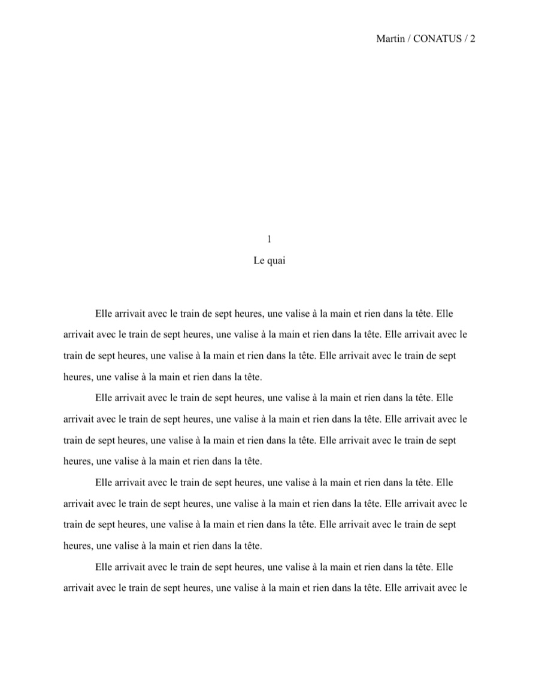 | 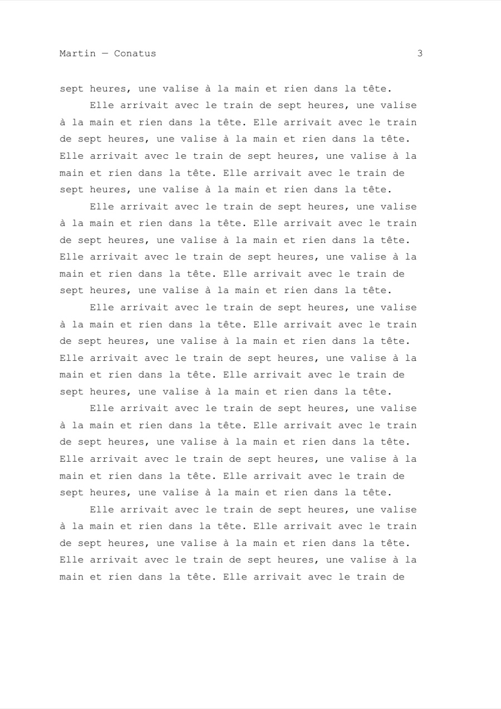 |

## Bringing a book in

The welcome screen opens a book that already exists, and leaves the original untouched:

- **A folder** of Markdown files: they become the chapters, as they are.
- **Word**: a `.docx`, cut into chapters and scenes at its headings.
- **Scrivener**: a `.scriv` project.
- **Ulysses**: sheets exported as Markdown.

## Price, and Musset Sync

Musset is free while it is a beta. From version 1.0 it will cost **US$9.90, once**. It stays open source under the
GPL: you may always build it yourself from this repository.

**Musset Sync** (€4.99 a month) is the optional service behind it:

- your books in the cloud, with their whole history;
- the same book on all your Macs, offline first;
- sharing a book with an editor or beta readers, who do not pay;
- who wrote what, and their changes coming back as corrections.

Sync is built on git: Musset pushes and pulls your book’s history; nothing about your files changes.

## Your book on disk

A book is a folder. Musset reads and writes only its chapter files, the `bible/` folder and the hidden `.musset/` folder;
everything else in the folder is left alone.

```
My Book/
├── 01_the_ferry.md          chapters: plain Markdown, one file each
├── 02_the_salt_works.md
├── bible/                   characters, places, timeline, documents, cuts
└── .musset/
    ├── book.json            title, author, language, chapter order, export presets
    ├── notes/               margin notes, one file per chapter
    ├── versions/            other versions of a chapter
    ├── plot.json            the plot grid
    ├── exports/             PDFs, DOCX and EPUB files
    └── …                    rubric, writing rules, dictionary, state (git-ignored)
```

- Scenes are marked by a comment line of their own: `<!-- scene: Morning crossing -->`.
- Footnotes are Markdown footnotes: `text[^1]` … `[^1]: The note.`
- The history is a regular git repository in the book folder. Musset commits as you write; no git knowledge is needed.

## Shortcuts

| | |
|---|---|
| ⌘K | Command bar |
| ⌘1 · ⌘2 · ⌘3 · ⌘4 · ⌘6 · ⌘7 | Chapters · Notes · Chat · Stats · Plan · History |
| ⌘5 | Plot grid |
| ⇧⌘E · ⇧⌘R | Revise · Read |
| ⇧⌘D · ⇧⌘T | Focus mode · Typewriter scrolling |
| ⌃⌘K · ⌃⌘U | Kiosk mode · Ultra Focus |
| ⌃⌘R · ⌃⌘M · ⌃⌘L | Repetitions · Minimap · Line numbers |
| ⌥⌘N · ⇧⌘N | Add a note · New scene here |
| ⇧⌘M | Comment |
| ⌥⌘] · ⌥⌘↩ · ⌥⌘⌫ | Next correction · Accept · Refuse |
| ⌘; | Next proofreading suggestion |
| ⇧⌘F · ⌥⌘F | Search the book · Find and replace |
| ⌘E · ⌘S | Export · Save a snapshot |
| ⌥⌘H · ⌥⌘B | History · Who wrote what |
| ⇧⌘H | All books |

## Privacy

- **On your Mac:** your books, their history, typography, spelling and grammar (LanguageTool runs locally).
- **Sent to an AI provider, only when you turn the AI on and ask:** the passages or chapters the feature needs, through
  your own account with that provider, under its terms.
- **Sent to Pangram, only if you add your own Pangram key and run a check:** the passage being checked for AI
  writing. The key stays in your Keychain.
- **Sent to Musset Sync, only if you subscribe:** your book’s files and history.
- **Sent to languagetool.org, only if you choose it** instead of the LanguageTool inside Musset.
- **Sent to Apple Maps, Open Library or Crossref, only when you look something up:** a place you search for on a
  board, or the ISBN or DOI of a source you add.
- **The update check.** Once a day Musset asks musset.app whether there is a newer version. The server adds one to a
  counter, by day, version and country, and does the same for downloads. No address and no identifier is kept; the
  code is in [`website/stats`](website/stats).
- No analytics, no tracking, no account needed to write.

## Install

[Download the DMG](https://musset.app/download) from [musset.app](https://musset.app), open it and drag Musset to
Applications. It is signed and notarized by Apple, and updates itself from then on.

Requires **macOS 14 Sonoma or later on Apple silicon**. A build for Intel Macs is being tested:
see [issue 1](https://github.com/Musset-App/musset/issues/1).

## Build from source

You need Xcode 26.5 (older versions may not compile it), [Rust](https://rustup.rs) and
[XcodeGen](https://github.com/yonaskolb/XcodeGen).

```sh
brew install xcodegen
git clone https://github.com/Musset-App/musset.git musset && cd musset
scripts/build-typeset.sh --mac-only   # the typesetter (Rust, on the Typst library); adds the Rust targets it needs
xcodegen generate
open Musset.xcodeproj                 # or: xcodebuild -scheme Musset build
```

The first build downloads and checks, each against a pinned SHA-256, into `~/Library/Caches/Musset-build`:

- **pandoc** 3.9.0.2 (`scripts/fetch-pandoc.sh`), for DOCX, EPUB and Word import;
- **LanguageTool** 6.6 trimmed to the six languages, with a small Java runtime made with `jlink` from Eclipse Temurin
  21 (`scripts/fetch-languagetool.sh`).

Typst is not a separate program: it is built into Musset as a library, by `scripts/build-typeset.sh`.

**A signed, notarized DMG** (needs a Developer ID and notary credentials stored with
`xcrun notarytool store-credentials AC_NOTARY`):

```sh
MUSSET_SIGN_IDENTITY="Developer ID Application: Your Name (TEAMID)" zsh scripts/package.sh
zsh scripts/package.sh --sign-only     # sign, no notarization
```

By default the app is built for Apple silicon. `MUSSET_ARCHS="arm64 x86_64"` builds one app for both chips,
`MUSSET_ARCHS=x86_64` one for Intel alone.

`package.sh` signs the bundled tools, the Java runtime and the native libraries inside LanguageTool’s jars, notarizes
the app and the DMG, staples both, and checks the result with Gatekeeper.

## Tests

```sh
xcodebuild test -project Musset.xcodeproj -scheme Musset
```

To run the tests while using Musset, give them their own build folder and bundle id, so the open app is untouched:

```sh
xcodebuild test -project Musset.xcodeproj -scheme Musset -derivedDataPath /tmp/musset-tests \
  PRODUCT_BUNDLE_IDENTIFIER=dev.scratch.musset.tests
```

Tests that read the author’s own books skip themselves here: those books are not in this repository.

Some tests run only on request, because they call an AI, need a real book or render screenshots. They are skipped
unless their environment variable is set (prefixed with `TEST_RUNNER_` when passed to `xcodebuild`):

| Variable | What it runs |
|---|---|
| `MUSSET_LIVE=1` | Live AI calls (plot index, critique, exports of a real book) |
| `MUSSET_SNAPSHOT=<dir>` | Screenshots of screens and panels |
| `MUSSET_SITE_SHOTS=<dir>` | The screenshots in this README, on a demo book |
| `MUSSET_PROOF_BOOK=<book>` | Proofreading a real book (with `MUSSET_ARBITER_REAL=sonnet` for the AI arbiter) |
| `MUSSET_PERF=1` | Timings on a copy of a real book |

## Project layout

```
Musset/
├── App/            app state, a book’s session (chapters, versions, tracks, Word review), kiosk mode
├── Editor/         the text view, keyboard modes, typography, revisions, focus, minimap
├── Model/          the book on disk: manifest, chapters, scenes, languages
├── Notes/          margin notes
├── Bible/          the Bible, todos, quick capture
├── AI/             the editor inside: notes, critique, rubric, checkers, chat, proofreading, LanguageTool
├── Export/         Typst, pandoc, Word round trip, manuscript norms
├── Git/            history, tracks, sync
├── Collab/         accounts, sharing, who wrote what
├── Views/          the interface
└── Resources/      fonts, Typst templates, rubric, translations
MussetTests/        unit, integration and opt-in live tests
MussetReader/       Musset Reader for iPhone and iPad
musset-typeset/     the typesetter: Rust, on the Typst library
Packages/           MussetPage, the Swift package around the typesetter
scripts/            fetching pandoc and LanguageTool, packaging, screenshots, localization tools
website/            musset.app: the pages, the download and update functions, the counters
screenshots/        the pictures in this README
```

## Translating the interface

Interface text is written in English in the code and looked up in `Musset/Resources/Localization/<language>.json`:

```swift
Text(L("Export…"))                                  // a plain string
Text(L("\(count) notes may lose their passage."))   // {%0} in the key; "one"/"other" forms in the tables
Text(L("Done", ctx: "Écrit"))                       // two senses of the same English, told apart
```

- A new string needs an entry in every table (`fr`, `de`, `es`, `it`, `pt-BR`, `pt-PT`; `en.json` only for plurals).
- `python3 scripts/l10n-migrate.py --keys` lists every key in the code; `LocalizationTests` checks that each language has
  them all, with the same placeholders.
- Words printed in the book itself (Contents, Acknowledgements…) follow the book’s language, in `BookTerm`.

## Contributing

Issues and pull requests are welcome. A few principles guide what goes in:

1. **Musset never generates the author’s text.** Features may read, quote, question and annotate; they do not write
   prose for the book.
2. **The author’s files are sacred.** Musset writes only chapter files, `bible/` and `.musset/`, and never deletes
   anything without a way back.
3. **Everything works with the AI off.**
4. **The keyboard first; calm by default.** A feature earns its place in the interface.
5. **Tests with real text.** Add or update tests with each change; run the full suite before a pull request.

## Licence

Musset is free software, released under the **GNU General Public License, version 3** — see [`LICENSE`](LICENSE).
The programs and fonts bundled with the app keep their own licences, listed in
[`THIRD-PARTY-NOTICES.md`](THIRD-PARTY-NOTICES.md).

“Musset” and its icon identify the official app; please give a modified version another name.
